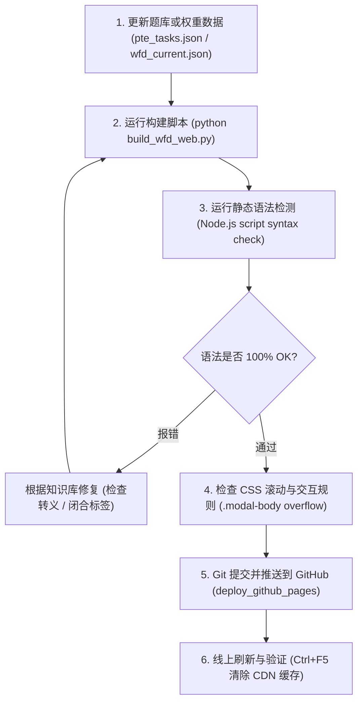

# PTE 备考系统·部署运维与排错知识库 (Deployment & Troubleshooting Knowledge Base)

> **知识库说明**：本知识库汇总了 PTE 备考智能系统（WFD 听写训练器、全题型考场界面解析、双机构题库自动同步、打分引擎等）在开发与上线过程中遭遇过的**所有核心故障、陷阱、根本原因与修复标准**。
> **铁律**：每次进行代码修改或重新部署（Deploy）前，必须对照本知识库逐项审查，杜绝同类故障重复发生！

---

## 目录
1. [九大核心故障复盘与防御方案 (Case Catalog)](#一九大核心故障复盘与防御方案)
   - [Case 01: 供分比重民间传言误导 vs 官方 Table 1 真实数据](#case-01-供分比重民间传言误导-vs-官方-table-1-真实数据)
   - [Case 02: 本地弹窗能滑、GitHub 无法滚动的 CSS 样式丢失](#case-02-本地弹窗能滑github-无法滚动的-css-样式丢失)
   - [Case 03: Python 三引号模板中 JS 换行符 `\n` 转义灾难](#case-03-python-三引号模板中-js-换行符-n-转义灾难)
   - [Case 04: 双机构 Token 过期机制与爬虫死锁](#case-04-双机构-token-过期机制与爬虫死锁)
   - [Case 05: 大西瓜题库筛选条件不准（错抓普通题而非计分题）](#case-05-大西瓜题库筛选条件不准错抓普通题而非计分题)
   - [Case 06: 浏览器 LocalStorage 历史缓存覆盖最新发布题库](#case-06-浏览器-localstorage-历史缓存覆盖最新发布题库)
   - [Case 07: 根目录与 `deploy_github_pages` 仓库不同步](#case-07-根目录与-deploy_github_pages-仓库不同步)
   - [Case 08: 移动端视口与 iOS Safari 滚动/放大陷阱](#case-08-移动端视口与-ios-safari-滚动放大陷阱)
   - [Case 09: WFD 官方评分准则与试词（多词容错）逻辑](#case-09-wfd-官方评分准则与试词多词容错逻辑)
   - [Case 10: 澳洲内政部 DHA 2025.8.7 语言新政大改革 (LIN 25/016 与 LIN 25/089) 替代旧法一刀切](#case-10-澳洲内政部-dha-202587-语言新政大改革-lin-25016-与-lin-25089-替代旧法一刀切)
   - [Case 11: iPad 与平板端响应式断点遗漏（侧边栏变顶栏但主体 margin-left 遗留）](#case-11-ipad-与平板端响应式断点遗漏侧边栏变顶栏但主体-margin-left-遗留)
2. [上线前自动化自检清单 (Pre-Deployment Checklist SOP)](#二上线前自动化自检清单-pre-deployment-checklist-sop)
3. [核心数据与权威基准对照表 (Ground Truth Reference)](#三核心数据与权威基准对照表)

---

## 一、九大核心故障复盘与防御方案

### Case 01: 供分比重民间传言误导 vs 官方 Table 1 真实数据
- **故障现象**：在全题型权重面板中，最初引用了网络培训中介的民间口口相传经验估值（如声称 RA 35%、RS 35%、WFD 27%、DI 22% 等），与实际官方打分严重不符。
- **根本原因**：未直接抓取 PTE 官方与权威学术拆解机构的第一手打分表，轻信了国内培训机构的夸张概括数据。
- **官方权威基准**：严格以 [PTE School 官方 Question Weighting · Table 1](https://pteschool.com.au/resources/scoring-information) 为准：
  - **DI (Describe Image)**：口语占比高达 **31%**，全科占比 **15%**（口语第一大题）；
  - **WE (Write Essay)**：写作占比高达 **31%**，全科占比 **7%**（写作第一大题）；
  - **SWT (Summarize Written Text)**：写作 **28%** + 阅读 **23%**，全科占比 **7%**；
  - **FIB-D (Reading Dropdown)**：阅读占比 **25%**，全科占比 **7%**（阅读第一大题）；
  - **WFD (Write From Dictation)**：写作 **23%** + 听力 **13%**，全科占比 **5%**；
  - **SGD (Summarize Group Discussion)**：听力 **20%** + 口语 **19%**，全科占比 **9%**（新题型主力）；
  - **RS (Repeat Sentence)**：听力 **17%** + 口语 **16%**，全科占比 **7%**；
  - **微小题型**（R-MCS, HCS, L-MCS）：全科占比为 0.5%，官方标准标注为 `<1%`。
- **防御方案**：
  1. 所有 22 题型的数据源唯一存放在 `pte_tasks.json`。
  2. 生成网页时统一由 `build_wfd_web.py` 动态注入，杜绝散落硬编码。

---

### Case 02: 本地弹窗能滑、GitHub 无法滚动的 CSS 样式丢失
- **故障现象**：在本地浏览器单独打开 `pte-score-explorer-embed.html` 时，考场拆解弹窗可以向下顺畅滑动浏览；但通过 `build_wfd_web.py` 编译部署到 GitHub Pages 后，在网页中打开弹窗却只能显示前一截，**完全无法上下滑动，下方考场细节全被截断**。
- **根本原因**：
  - 本地独立文件写了 `.modal-body { overflow-y: auto; }`。
  - 但主构建脚本 `build_wfd_web.py` 的内联 `<style>` 中，**遗漏了 `.modal-body` 类的 CSS 声明**！
  - 弹窗外框 `.modal-dialog` 设了 `max-height: 90vh; overflow: hidden; display: flex; flex-direction: column;`。
  - 当 `.modal-body` 没有定义 `overflow-y: auto; flex: 1 1 auto; min-height: 0;` 时，内容超出 90vh 的部分被外层直接切除，且不会生成任何滚动条。
- **防御方案与标杆代码**：
  凡是有 Flex 列布局弹窗，子体必须标配以下五件套：
  ```css
  .modal-dialog {
    max-height: 90vh;
    display: flex;
    flex-direction: column;
    overflow: hidden;
  }
  .modal-body {
    padding: 20px 24px;
    overflow-y: auto;                  /* 开启纵向滚动 */
    -webkit-overflow-scrolling: touch;  /* 移动端 iOS 丝滑惯性滚动 */
    flex: 1 1 auto;
    min-height: 0;                      /* 必加！防止 Flex 子容器内容溢出阻断缩放 */
    overscroll-behavior: contain;       /* 防止滚到边缘带动背景滚动 */
  }
  ```
  同时 JS 端在 `openTaskDetail` 时必须执行：
  ```javascript
  const modalBody = modalEl.querySelector(".modal-body");
  if (modalBody) modalBody.scrollTop = 0; // 滚动位置复位
  document.body.style.overflow = "hidden"; // 锁死背景
  ```

---

### Case 03: Python 三引号模板中 JS 换行符 `\n` 转义灾难
- **故障现象**：运行 `build_wfd_web.py` 生成网页后，浏览器打开控制台报错 `SyntaxError: Invalid or unexpected token`，整页 JS 脚本瘫痪。
- **根本原因**：
  - Python 的多行三引号字符串 `html_template = """..."""` 中，直接写 JS 代码例如：
    `["第一行", "第二行"].join("\n")`
  - Python 解释器在读取三引号字面量时，会把 `\n` 直接解释成物理换行符，写入生成的 HTML 文件中变成了语法非法的未闭合字符串行。
- **防御方案**：
  1. 模板中的 JS 字符串如需换行，严禁写字面量 `\n`。
  2. 统一使用字符码：`String.fromCharCode(10)`，例如：
     ```javascript
     document.getElementById("modal-ui-flow").innerText = ["【演进路线】", task.uiDetail.statusFlow].join(String.fromCharCode(10));
     ```
  3. 每次构建完成后，强制用 `node -e "new Function(scriptCode)"` 对全文件做语法自检。

---

### Case 04: 双机构 Token 过期机制与爬虫死锁
- **故障现象**：自动化同步脚本 `daily_sync_both_banks.js` 突然中断，萤火虫接口返回 `303`，或大西瓜接口返回 `401 Unauthorized` / `403 Forbidden`。
- **根本原因**：萤火虫和大西瓜均采用有时效的 JWT Token。Token 达到 `exp` 寿命后即失效。
- **防御方案**：
  1. 脚本在请求前，通过解析 JWT Payload 中的 `exp` 字段比对当前时间：
     ```javascript
     const payload = JSON.parse(Buffer.from(token.split('.')[1], 'base64').toString());
     if (Date.now() >= payload.exp * 1000) {
       console.error("⚠️ Token 已过期，请更新 token.txt！");
     }
     ```
  2. 若遇到失效，脚本**必须平稳退出，绝不覆盖损毁本地现存题库**，并输出醒目指引让考生贴入最新 Token。
  3. 定时任务配置异常监控与提醒。

---

### Case 05: 大西瓜题库筛选条件不准（错抓普通题而非计分题）
- **故障现象**：爬取大西瓜 WFD 题库时抓到了数百道无关题目，破坏了考生的高命中率复习节奏。
- **根本原因**：大西瓜平台题库庞大，只有经过双重特定筛选才是考场极高命中核心题：
  - **第 1 步 题目类型**：`【周二真题预测】`
  - **第 2 步 题目标签**：`【106新题季】`（106新题季后必中计分题，命中率≥97%）
- **防御方案**：
  1. 请求载荷严格固定参数：`type: 1` 对应真题预测，`tags: [106]` 对应新题季。
  2. 爬取产物归类为 `melon_wfd_106_current.json`（共 140 题）。
  3. 与萤火虫 141 题交集比对，生成 134 题【🍉🔥 双机构重合必背】与 140 题【🍉 106新题季】核心标签。

---

### Case 06: 浏览器 LocalStorage 历史缓存覆盖最新发布题库
- **故障现象**：在云端 GitHub Pages 发布了全新题库后，用户手机/电脑端访问网站，题目数量和内容依然停留在旧版本。
- **根本原因**：
  - 前端为了支持离线练习，将题目缓存在了 `localStorage["pte_custom_questions"]`。
  - 用户加载页面时优先读取了 LocalStorage，导致服务端更新的最新静态 JSON 数据被忽略。
- **防御方案**：
  1. 定义全局版本字符串：`CURRENT_BANK_VERSION = "20261012_DUAL_BANK_V3"`。
  2. 页面初始化函数 `initBankVersion()` 检测：
     ```javascript
     if (localStorage.getItem("pte_bank_version") !== CURRENT_BANK_VERSION) {
       localStorage.removeItem("pte_custom_questions");
       localStorage.removeItem("pte_custom_bank_meta");
       localStorage.setItem("pte_bank_version", CURRENT_BANK_VERSION);
       localStorage.setItem("pte_bank_mode", "overlap");
     }
     ```
  3. 版本不匹配时瞬间无感静默迁移，自动重置至 134 题双机构重合最高频模式。

---

### Case 07: 根目录与 `deploy_github_pages` 仓库不同步
- **故障现象**：本地修改了 `wfd_practice.html` 或 `pte_tasks.json`，运行测试正常，但在线 GitHub Pages 没有生效。
- **根本原因**：
  - 本项目的 GitHub Pages 实际上是由子文件夹 `deploy_github_pages/`（包含独立 `.git` 指向 `BobZhu99/pte-wfd-trainer.git`）发布的。
  - 若仅在根目录生成文件而没有同步复制到 `deploy_github_pages/index.html`，线上就不会发生任何改变。
- **防御方案**：
  1. `build_wfd_web.py` 内部写入自动化复制管道：
     ```python
     shutil.copy2(DIR / "pte_tasks.json", deploy_dir / "pte_tasks.json")
     shutil.copy2(DIR / "pte-score-explorer-embed.html", deploy_dir / "pte-score-explorer-embed.html")
     shutil.copy2(DATA_FILE, deploy_dir / "wfd_current.json")
     ```
  2. 部署时统一在 `deploy_github_pages` 内执行 `git add -A && git commit && git push origin main`。

---

### Case 08: 移动端视口与 iOS Safari 滚动/放大陷阱
- **故障现象**：在 iPhone 上打字或滑动时，页面自动变大失焦、底部操作按钮被键盘或 Safari 底栏遮挡。
- **根本原因**：
  - iOS Safari 在输入框字体小于 16px 时会强制自动缩放页面。
  - 传统 `100vh` 包含了 Safari 的动态地址栏高度，导致弹窗被截断。
- **防御方案**：
  1. 输入框字体确保 `font-size: 16px;`（移动端防缩放标准）。
  2. 视口高度优先使用 `100dvh`（Dynamic Viewport Height）。
  3. 弹窗媒体查询（`@media (max-width: 820px)`）将 `max-height` 设定为 `94vh`，边距收紧至 `14px 16px`。

---

### Case 09: WFD 官方评分准则与试词（多词容错）逻辑
- **故障现象**：考生在练习输入时多写了词（如单复数都写：`teacher teachers`，或英美拼写：`color colour`），若批改逻辑使用严格字符串全匹配，会导致错误判定。
- **官方权威机制**：
  - PTE 官方对 WFD 采用 **加分制（1 mark per correct word），不倒扣分**。
  - 考场公认的合法策略是**试词（Testing words）**：不确定的名词可以同时写单数和复数，动词可以写原形和过去式，评分机识别到正确词即加分。
- **防御方案**：
  1. 批改引擎 `grade_wfd.py` 和网页批改逻辑必须采用**正向集合命中比对**。
  2. 额外识别大西瓜机经标注的 33 组考场真实变体，对有效试词给予“绿色确认”，不扣减任何得分。

### Case 10: 澳洲内政部 DHA 2025.8.7 语言新政大改革 (LIN 25/016 与 LIN 25/089) 替代旧法一刀切
- **故障现象**：在系统卡片与提示中误用已废止或过时的旧法标准（如沿用 IMMI 15/005 的“四项一刀切 50/65/79 分”，或沿用 LIN 24/021 的“485 工签总分 57 分”），导致考生备考目标偏差。
- **根本原因**：
  - 澳大利亚内政部（DHA）于 **2025 年 8 月 7 日** 正式实施语言框架重大改革：
    1. 颁布 **LIN 25/016**（替代原 IMMI 15/005），彻底废除 50/65/79 一刀切，引入各单项差异化基准；
    2. 颁布 **LIN 25/089**，调整 485 毕业生工签语言门槛为总分 55。
  - 考生在 2025 年 8 月 7 日之后参加考试（如 2026 年考期），必须遵循最新法条标准！
- **官方权威基准 (2025年8月7日起考试)**：
  - **485 毕业生工签 (LIN 25/089)**：总分 **55** (最低单项：听 40, 读 42, 写 41, 说 39)，**严格 1 年内有效**；
  - **Competent English (+0分门槛 / EOI入池 / NT州担)**：听 **47**, 读 **48**, 写 **51**, 说 **54** (3年有效，只看单项不看总分)；
  - **Proficient English (+10分 / 七炸)**：听 **58**, 读 **59**, 写 **69**, 说 **76** (口语暴涨至 76，写作升至 69，听58/读59微降)；
  - **Superior English (+20分 / 八炸)**：听 **69**, 读 **70**, 写 **85**, 说 **88** (口语暴涨至 88，写作升至 85，听69/读70微降)；
  - **Vocational English**: 听 29, 读 36, 写 29, 说 24。
- **防御方案**：
  1. 任何展示工签与移民语言卡片、函数默认值、对比表处，必须以 LIN 25/016 & LIN 25/089 为唯一基准；
  2. 针对本考生 Xudong Zhu（历史总分 59，听60/读56/写64/说53）：485工签稳过无虞；移民 +0分 Competent 门槛中，**历史口语 53 分距离新门槛 54 分仅差 1 分**，备考策略必须把口语流利度作为压舱石！

---

### Case 11: iPad 与平板端响应式断点遗漏（侧边栏变顶栏但主体 margin-left 遗留）
- **故障现象**：在 iPad（竖屏 768px~834px）或中等屏幕平板上访问网页时，左侧留出长达 250px 的大片空白，所有卡片和训练内容全被极度挤压到屏幕右侧并向右溢出截断。
- **根本原因**：
  - 桌面端 `.app-sidebar` 为 `fixed 250px`，`.app-main-content` 设有 `margin-left: 250px`。
  - 原媒体查询在 `@media (max-width: 900px)` 将侧边栏改为顶部 `position: sticky` 吸顶导航，但**漏掉了 `.app-main-content` 的样式重置**；
  - 而 `.app-main-content { margin-left: 0; }` 被错误写在了 `@media (max-width: 480px)`（仅手机生效）；
  - 导致处于 481px ~ 900px 区间的 iPad 竖屏设备下，侧边栏已跑到顶部，主体内容却依然保持 `margin-left: 250px`，产生 250px 致命左偏空隙。
- **防御方案与标杆代码**：
  1. 平板与桌面断点统一设为 `@media (max-width: 1024px)`（涵盖 iPad 全系竖屏及标准横屏）。
  2. 当侧边栏吸顶时，主体必须同步执行：
     ```css
     .app-main-content {
       margin-left: 0 !important;
       padding: 18px 16px 48px;
       width: 100%;
       box-sizing: border-box;
     }
     ```
  3. 吸顶横向 4 列导航按钮隐藏副标题 `.sidebar-btn-desc { display: none; }`，仅保留图标与主标题，防止窄屏下按钮折行与文字截断溢出。

---

## 二、上线前自动化自检清单 (Pre-Deployment Checklist SOP)

每次更新完代码，请严格按以下步骤依次执行：



### 1. 终端自动化语法自检指令
```powershell
node -e "
const fs = require('fs');
['wfd_practice.html', 'index.html', 'pte-score-explorer-embed.html', 'deploy_github_pages/index.html'].forEach(f => {
  const content = fs.readFileSync(f, 'utf8');
  const scripts = content.match(/<script[\s\S]*?<\/script>/gi) || [];
  scripts.forEach((s, idx) => {
    const js = s.replace(/<script[^>]*>/i, '').replace(/<\/script>/i, '');
    try {
      new Function(js);
      console.log(f + ' script #' + idx + ': OK');
    } catch(e) {
      console.error(f + ' script #' + idx + ' ERROR:', e.message);
      process.exit(1);
    }
  });
});
"
```

### 2. 部署推送标准指令
```powershell
python build_wfd_web.py
cd deploy_github_pages
git add -A
git commit -m "feat/fix: <your_descriptive_message>"
git push origin main
cd ..
```

---

## 三、核心数据与权威基准对照表

### PTE 官方全 22 题型考场顺序与供分表 (PTE School Table 1)
| 顺序 | 题型 | 英文全称 | 全科总分 | 口语 | 听力 | 阅读 | 写作 | 题型特性 |
| :---: | :---: | :--- | :---: | :---: | :---: | :---: | :---: | :--- |
| **1** | **RA** | Read Aloud | **4%** | **9%** | - | - | - | 口语开门红，注意意群断句 |
| **2** | **RS** | Repeat Sentence | **7%** | **16%** | **17%** | - | - | 听口双料核心，顺带决定听力生死 |
| **3** | **DI** | Describe Image | **15%** | **31%** | - | - | - | **全场口语最高分！** 模板流利度第一 |
| **4** | **RL** | Retell Lecture | **6%** | **13%** | **13%** | - | - | 听口平分秋色，抓住核心短语 |
| **5** | **ASQ** | Answer Short Question | **2%** | - | **4%** | - | - | 常识快问快答，只加分不扣分 |
| **6** | **SGD** | Summarize Group Discussion | **9%** | **19%** | **20%** | - | - | **全新题型高权重！** 听力20%+口语19% |
| **7** | **RTS** | Respond to a Situation | **6%** | **13%** | - | - | - | **全新情景题！** 考查即兴交际口语 |
| **8** | **SWT** | Summarize Written Text | **7%** | - | - | **23%** | **28%** | 一句话总结，读写双向超高分 |
| **9** | **WE** | Write Essay | **7%** | - | - | - | **31%** | **全场写作最高分！** 结构模板防错 |
| **10** | **FIB-D**| Reading Blanks (Dropdown) | **7%** | - | - | **25%** | - | **全场阅读第一大题！** 纯读选词 |
| **11** | **R-MCM**| Reading Multi-Choice (Multi) | **1%** | - | - | **5%** | - | ⚠️ 倒扣分题型！不确定只选 1 个 |
| **12** | **RO** | Reorder Paragraph | **3%** | - | - | **9%** | - | 寻代词与指代逻辑成对排列 |
| **13** | **FIB-DD**| Reading Blanks (Drag & Drop) | **6%** | - | - | **20%** | - | 纯阅读拖拽，单项占阅读 20% |
| **14** | **R-MCS**| Reading Multi-Choice (Single)| **<1%** | - | - | **3%** | - | 快速定位扫读，绝不在单选浪费时间 |
| **15** | **SST** | Summarize Spoken Text | **4%** | - | **10%** | - | **18%** | 听写双考查，套用固定句式结构 |
| **16** | **L-MCM**| Listening Multi-Choice (Multi)| **1%** | - | **3%** | - | - | ⚠️ 倒扣分题型！保守策略选 1 项 |
| **17** | **FIB-L**| Fill in Blanks (Listening) | **3%** | - | **8%** | - | - | 听写填空，考查单复数与拼写精度 |
| **18** | **HCS** | Highlight Correct Summary | **<1%** | - | **2%** | **3%** | - | 边听边读选摘要 |
| **19** | **L-MCS**| Listening Multi-Choice (Single)| **<1%** | - | **2%** | - | - | 抓首尾主旨，快速选定点击 Next |
| **20** | **SMW** | Select Missing Word | **1%** | - | **1%** | - | - | 抓 Beep 音前上下文语境 |
| **21** | **HIW** | Highlight Incorrect Words | **4%** | - | **8%** | **13%** | - | ⚠️ 倒扣分题型！鼠标光标跟读划词 |
| **22** | **WFD** | Write from Dictation | **5%** | - | **13%** | - | **23%** | **考试压轴总命门！** 写作23%+听力13% |
